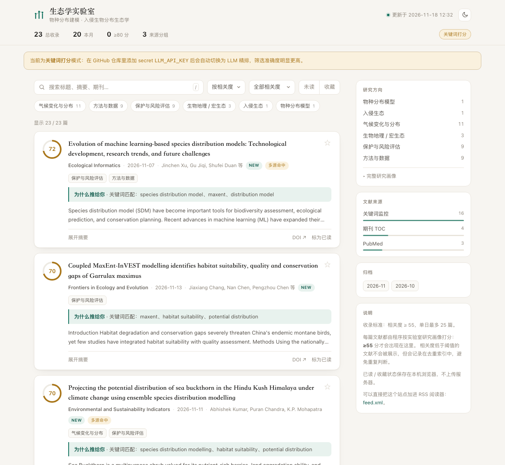

# 实验室文献速览 · LabPaperAgent

每天早上 7 点自动抓取订阅的文献，按实验室研究方向给每篇摘要打分，把**真正相关**的推到一个静态网页上。

网页可以直接发给全组同学，也能当 RSS 订阅，还能收藏导出成参考文献清单。

示例方向：广义生态学 · 物种分布建模（SDM/ENM）· 入侵生物分布生态学。换个 `lab.yml` 就能服务任何 lab。



> 截图是没配 LLM key 时的「关键词打分」状态（顶部有黄色提示）。配上 key 之后每篇会多出一条中文推荐理由和 1–3 个方向标签。

---

## 1. 它怎么工作

```
 config/feeds.yml            config/lab.yml
 订阅源定义                   研究画像 + 词表 + 阈值
      │                            │
      ▼                            │
┌──────────────────────┐           │
│ 抓取                  │           │
│  · OpenAlex（关键词/ISSN）        │
│  · PubMed E-utilities │           │
│  · bioRxiv / 期刊 RSS │           │
└──────────┬───────────┘           │
           ▼                       │
   跨源去重（DOI + 标题指纹）        │
           ▼                       │
   摘要回填（OpenAlex→Crossref→EuropePMC→S2）
           ▼                       │
┌──────────────────────────────────┴───┐
│ 打分                                   │
│  1. 关键词加权打分（永远可用，零成本）      │
│  2. LLM 精排（读摘要判断，写推荐理由+标签） │
└──────────────────┬───────────────────┘
                   ▼
            ≥ 阈值 的文献
                   ▼
   docs/data/digest.json + 月度归档 + feed.xml
                   ▼
      GitHub Actions 自动 commit → GitHub Pages
                   ▼
              实验室网页
```

三个设计取舍值得知道：

- **PubMed 官方「检索式 RSS」已经停用**（NCBI 2022 年下线）。本项目用 E-utilities（`esearch` + `efetch`）等效实现，检索式写法完全一样，还能顺带拿到完整结构化摘要。
- **纯生态学期刊大多不在 PubMed**。`Ecography`、`Journal of Ecology`、`Journal of Biogeography`、`Diversity and Distributions` 这些刊在 PubMed 里的记录只有几十条，靠 PubMed 会漏掉你 lab 最核心的文献。所以主通道用 **OpenAlex**（1.2 亿+ 作品，免 key，含摘要）。
- **很多期刊 TOC 根本没有摘要**（Wiley、Springer、Elsevier 的 RSS 只有标题，ScienceDirect/MDPI 直接反爬 403）。所以有一步「摘要回填」，缺失时按 DOI 逐级去 OpenAlex / Crossref / Europe PMC / Semantic Scholar 找。

---

## 2. 五分钟本地跑通

```bash
# 1. 依赖
make setup            # 或 python3 -m venv .venv && .venv/bin/pip install -r requirements.txt

# 2. 试跑（不写文件，先看效果）
.venv/bin/python scripts/run.py --dry-run

# 3. 真正跑一次，生成网页数据
.venv/bin/python scripts/run.py

# 4. 本地预览
make serve            # http://localhost:8000
```

没配 LLM key 也能跑，会自动降级成关键词打分（网页上会有黄色提示）。想开 LLM：

```bash
export LLM_API_KEY=sk-xxxx        # DeepSeek / OpenAI / 任何 OpenAI 兼容网关
.venv/bin/python scripts/run.py
```

**不想花 token 也想验证 LLM 链路？** 用自带的 mock 服务（返回固定的假打分，只验管道）：

```bash
python tests/mock_llm_server.py 8765 &
LLM_API_KEY=test LLM_BASE_URL=http://127.0.0.1:8765/v1 \
  .venv/bin/python scripts/run.py --only biorxiv-ecology --lookback 5
```

预期看到 `30/30 篇经 LLM 精排`、每篇多出 `mock：…` 的理由。若出现 `鉴权失败`，说明 key 或 base_url 没传进去。

---

## 3. 部署到 GitHub Pages

仓库内容已经配好，五步上线：

1. **建仓库并推送**
   ```bash
   cd LabPaperAgent
   git init -b main
   git add -A && git commit -m "init: lab paper digest"
   git remote add origin git@github.com:<你的账号>/LabPaperAgent.git
   git push -u origin main
   ```

2. **开 Pages**
   Settings → Pages → Source 选 **Deploy from a branch** → Branch 选 `main`、目录选 **`/docs`** → Save。
   一两分钟后站点地址是 `https://<账号>.github.io/LabPaperAgent/`。

3. **配 Secrets**（Settings → Secrets and variables → Actions → New repository secret）

   | Secret | 必填 | 说明 |
   |---|---|---|
   | `LLM_API_KEY` | 强烈建议 | LLM 打分用。不填则退回关键词模式 |
   | `LLM_BASE_URL` | 可选 | 默认 `https://api.deepseek.com/v1` |
   | `LLM_MODEL` | 可选 | 默认 `deepseek-chat` |
   | `OPENALEX_API_KEY` | 可选 | [免费申请](https://openalex.org/rest-api)，能显著减少匿名限流 |
   | `NOTIFY_WEBHOOK` / `NOTIFY_TYPE` | 可选 | 想推送到飞书/钉钉/Slack 群时填 |
   | `CONTACT_EMAIL` | 可选 | 学术 API 的礼貌标识，NCBJ/Crossref 会用它联系你 |

4. **先手动跑一次**
   Actions → 左侧「文献速览」→ Run workflow。
   勾 `no_llm` 可以先验证链路通不通、不花 token。跑完看日志末尾的入选列表。

5. **等自动运行**
   之后每天北京时间 07:00 自动跑。GitHub 免费额度的定时任务偶有几分钟延迟，属正常。

> 注意：GitHub Pages 在**私有仓库**上需要 Pro/Team 套餐。仓库是 private 时可以把 `docs/` 目录挂到 Cloudflare Pages 或 Vercel（免费），或者干脆把仓库设为 public。

---

## 4. 配置：改这里就够了

### 4.1 研究方向 → `config/lab.yml`

```yaml
lab:
  name: "生态学实验室"

  # ① 自然语言画像：直接拼进 LLM 提示词，写得越具体，筛得越准
  profile: |
    本实验室做物种分布建模与入侵生物分布生态学……
    我们关注空间分布的预测、解释与风险，不关注分子机制与临床医学。

  # ② 结构化方向：用于网页标签分组、关键词兜底打分
  interests:
    - key: sdm
      label: "物种分布模型"
      terms: ["species distribution model", "maxent", "biomod"]
```

**加一个新方向**（比如「城市生态学」）：

1. 在 `profile` 末尾补两三句，说明你关心它的哪个侧面（预测？评估？管理决策？）
2. 在 `interests` 里加一组 `key/label/terms`
3. 在 `lexicon.must` 里补几个高辨识度术语
4. 跑一次 `python scripts/run.py --rescore`（或 Actions 里勾 `rescore`）——它会把已归档的文献按新画像重算，不用等新文献

### 4.2 阈值与条数

```yaml
scoring:
  min_score: 55        # 低于它不展示
  max_per_run: 25      # 单日最多推几篇（超出的顺延，不会丢）
  max_llm_items: 120   # 单次最多给多少篇调 LLM，控成本
```

调参建议：第一周先设 `min_score: 50` 看入选质量，觉得掺水就提到 60–65。

### 4.3 订阅源 → `config/feeds.yml`

四类源，加一个 feed 就是加一段 YAML：

```yaml
# ① OpenAlex 关键词监控（生态学首选）
- id: oa-my-topic
  group: "关键词监控"
  name: "我的方向"
  type: openalex
  queries:
    - "urban ecology"
    - "city biodiversity"
  lookback_days: 14
  max_items: 50
```

```yaml
# ② 期刊整刊 TOC（用 ISSN，印刷版|电子版）。没有 RSS 的刊也能订。
- id: toc-ecography
  group: "期刊 TOC"
  name: "Ecography"
  type: openalex
  issn: "0906-7590|1600-0587"
  lookback_days: 20
```

```yaml
# ③ PubMed 检索式（语法和 PubMed 搜索框一致）
- id: pubmed-my-query
  group: "PubMed"
  name: "PubMed · 我的检索式"
  type: pubmed
  term: >
    ("invasive species"[tiab] OR "alien species"[tiab])
    AND ("climate change"[tiab])
  lookback_days: 30
  max_items: 40
```

```yaml
# ④ 任意 RSS / Atom（bioRxiv、arXiv、期刊官方 feed、实验室博客都行）
- id: my-rss
  group: "预印本"
  name: "bioRxiv · Ecology"
  type: rss
  url: "https://connect.biorxiv.org/biorxiv_xml.php?subject=ecology"
```

**找 ISSN**：期刊主页 → 关于/投稿页，或 [portal.issn.org](https://portal.issn.org)。
**找 RSS**：Nature 系 `https://www.nature.com/<刊名缩写>.rss`；bioRxiv 用上面的 subject 地址；arXiv 用 `https://rss.arxiv.org/rss/<分类>`。
Wiley / ScienceDirect / MDPI / Cell 的 RSS 现在基本都 403 或已下线，这类刊请用 ② 或 ③。

### 4.4 关键词词表

`lab.yml` 里的 `lexicon`：

- `must`：命中说明很可能相关，权重最高（标题命中 9 分、摘要命中 3.5 分）
- `boost`：上下文信号（`transferability`、`uncertainty`、`auc`…）
- `exclude`：命中显著扣分（跨领域检索时的噪声词，比如 `clinical trial`）

最终分 = `100 × raw / (raw + 14)`，raw 是加权和。低于 120 字符的摘要会被压到 55 分以下，避免「信息不足却拿高分」。

---

## 5. 每天怎么用

- **网页**：默认按相关度排序；`/` 键快速搜索；点标签或左侧来源筛选；分数环的颜色 = 相关度档位
- **已读 / 收藏**：存在浏览器本地（`localStorage`），不跨设备，不上传
- **导出收藏**：页脚 →「导出收藏」，得到 Markdown 文献清单（可直接贴进笔记或导入 Zotero 的 Markdown 导入）
- **RSS**：`<站点>/data/feed.xml`，塞进任意 RSS 阅读器
- **归档**：右侧选月份，看历史（按文章发表日期分月）
- **中文标签**：LLM 模式会给每篇 1–3 个方向标签，点标签即可只看某一类

---

## 6. 成本

| 项目 | 估算 |
|---|---|
| GitHub Actions | 每天一次约 3–6 分钟；public 仓库免费，private 约 150 分钟/月（免费额度 2000） |
| LLM（DeepSeek） | 每天约 100 篇摘要 ≈ 15 万 input token ≈ **0.02 元/天**，一个月几毛钱 |
| LLM（GPT-4o-mini） | 同量级，约 0.05 元/天 |
| OpenAlex / Crossref / Europe PMC / PubMed | 全部免费，无需 key（申请 OpenAlex key 只影响稳定性） |

---

## 7. 常见问题

**Q：Actions 报 `LLM 鉴权失败（HTTP 401）`**
Secret 名字必须是 `LLM_API_KEY`；换供应商时记得同时改 `LLM_BASE_URL` 和 `LLM_MODEL`。DeepSeek 的 base_url 是 `https://api.deepseek.com/v1`。

**Q：日志里一直 `OpenAlex 不可用，回退 Crossref`**
OpenAlex 匿名搜索在高峰期会被限流。申请一个免费 API key 填进 `OPENALEX_API_KEY` 基本就没了。没 key 时程序会自动熔断、全部改走 Crossref，结果质量略降但不断供。

**Q：某本期刊一篇都抓不到**
先确认 ISSN 写对（印刷版|电子版）。再确认这本刊在 OpenAlex 里有没有被收录（去 openalex.org 搜一次）。还不行就改用 PubMed 检索式，前提是该刊被 PubMed 索引。

**Q：想加「只看某个作者」**
在 `feeds.yml` 用 PubMed：`term: 'Smith JA[au] AND "species distribution"[tiab]'`，或 OpenAlex 的 `author.id`。后者需要先去 openalex.org 查作者 ID。

**Q：网页打开是空白 / 显示「无法读取数据」**
`docs/data/digest.json` 还没生成——先跑一次 `python scripts/run.py`，或等 Actions 跑完。本地直接双击 `index.html` 会因为 `file://` 协议读不到 JSON，请用 `make serve`。

**Q：想改抓取时间**
`.github/workflows/digest.yml` 里的 cron 是 UTC。`0 23 * * *` = 北京时间次日 07:00。改成 `0 0 * * *` = 北京时间 08:00。

**Q：会不会漏文献？**
`max_per_run` 截断的文献**不会**被标记为已读，下一次运行会重新参与排序。真正丢弃的只有低于阈值的，而且它们会被记录在 `data/state.json` 里不再重复打分开销。想回顾被丢掉的，把 `min_score` 调低后 `--rescore`。

---

## 8. 目录结构

```
config/
  lab.yml            研究画像、词表、阈值、LLM 设置
  feeds.yml          订阅源
scripts/
  run.py             主流程（命令行入口）
  fetchers.py        OpenAlex / PubMed / RSS / Crossref 抓取
  enrich.py          摘要回填（四级回退，并发）
  scoring.py         关键词打分 + LLM 精排
  store.py           去重状态、月度归档、digest、feed.xml、meta
  notify.py          可选：推送到 IM
  common.py          配置、文本清洗、日期解析、ID 归一化
docs/                GitHub Pages 站点（纯静态，无构建）
  index.html
  assets/style.css
  assets/app.js
  assets/preview.png
  data/digest.json   近 120 天滚动视图
  data/archive/      按文章发表日期分月归档
  data/meta.json     站点元信息（研究方向、统计、来源）
  data/feed.xml      RSS 输出
data/state.json      已看过的文献索引（去重 + 省 LLM 成本）
tests/mock_llm_server.py   假 LLM 服务，用来免费验证打分链路
.github/workflows/digest.yml   定时任务
```

---

## 9. 一句话总结

`config/lab.yml` 定义「你 lab 关心什么」，`config/feeds.yml` 定义「去哪里找」，其余全自动。
